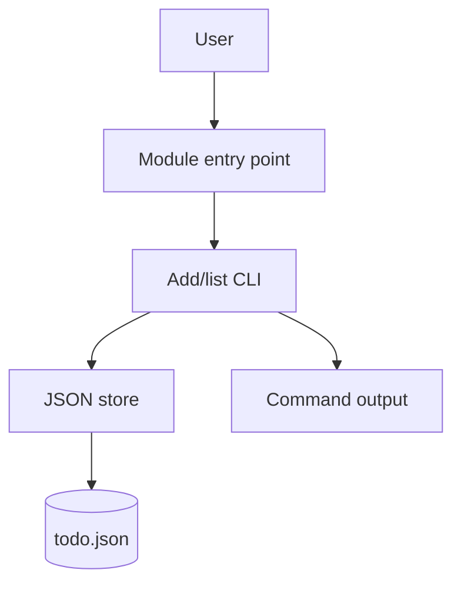

<h3>PR Summary by Qodo</h3>

Add todo add/list CLI with atomic JSON storage

<!-- qodo-describe-risk-badge -->
<!-- /qodo-describe-risk-badge -->
<code>✨ Enhancement</code> <code>🧪 Tests</code> <code>📝 Documentation</code> <code>🕐 20-40 Minutes</code>

<!-- qodo-describe-risk-slot -->

AI Description

<dl>
<dd>
 

><pre>
>• Add <b><i>python -m todo</i></b> commands to create and list open items.
>• Persist items in a validated JSON file with atomic saves, symlink support, and preserved
>  permissions.
>• Add 31 tests and record cold-review findings, fixes, and deferred work.
></pre>

</dd>
</dl>

Diagram

<dl>
<dd>

 

</dd>
</dl>

High-Level Assessment

<dl>
<dd>

 

>Keep the standard-library CLI and dedicated JSON store: they fit this milestone without a dependency or broader persistence redesign. Locking concurrent updates is a meaningful future extension, but the project explicitly defers it beyond phase 1.

</dd>
</dl>

 Files changed (10) <code> +611 / -0 </code> 

<dl>
<dd>

 

Enhancement (4) <code> +192 / -0 </code>

<dl>
<dd>

__init__.py<code>Create the todo package</code> <code>+1/-0</code>

 

>Create the todo package
>
><pre>
>• Adds the package marker and a short package description.
></pre>
>
><a href='https://github.com/SigorMatt/pet-todo/pull/2/files#diff-50473718195b424afaeb6f0bbaeeb571d9eff53f132d889e639d0ff7e207034c'>todo/__init__.py</a>

__main__.py<code>Enable python -m todo</code> <code>+7/-0</code>

 

>Enable python -m todo
>
><pre>
>• Calls the CLI and uses its return value as the process exit status.
></pre>
>
><a href='https://github.com/SigorMatt/pet-todo/pull/2/files#diff-18b840657f32b13539eac6940f328ae60b946de59442dc2be667f9edba55f3a8'>todo/__main__.py</a>

cli.py<code>Implement add and list commands</code> <code>+78/-0</code>

 

>Implement add and list commands
>
><pre>
>• Parses commands, assigns IDs, lists open items in ID order, and reports usage and storage failures with consistent stderr messages.
></pre>
>
><a href='https://github.com/SigorMatt/pet-todo/pull/2/files#diff-66ca6b1b3ce0ce9622a7f5e5bb0ec10d15c0b582687a63e9d17bacf393d063fa'>todo/cli.py</a>

store.py<code>Add validated, atomic JSON persistence</code> <code>+106/-0</code>

 

>Add validated, atomic JSON persistence
>
><pre>
>• Loads from TODO_FILE or todo.json, treating a missing file as empty and rejecting malformed data. Saves via a flushed and fsynced temporary file followed by replacement, while preserving symlinks and file permissions.
></pre>
>
><a href='https://github.com/SigorMatt/pet-todo/pull/2/files#diff-c7564f4bdfa07c8b5636c79fe9d89296b821f29291202a86bd6bae6f741ccdcf'>todo/store.py</a>

</dd>
</dl>

Tests (3) <code> +344 / -0 </code>

<dl>
<dd>

__init__.py<code>Make tests importable as a package</code> <code>+0/-0</code>

 

>Make tests importable as a package
>
><pre>
>• Adds the package marker used by the unittest discovery command.
></pre>
>
><a href='https://github.com/SigorMatt/pet-todo/pull/2/files#diff-001e61d97d9dee27d0c5aa1f23ba6c1972cd8a2e8320bac839656b0ab935b84d'>tests/__init__.py</a>

test_cli.py<code>Test add/list behavior and CLI errors</code> <code>+176/-0</code>

 

>Test add/list behavior and CLI errors
>
><pre>
>• Covers item creation, ordered listings, usage and read/write errors, and end-to-end module execution.
></pre>
>
><a href='https://github.com/SigorMatt/pet-todo/pull/2/files#diff-4e8715c7a425ee52e74b7df4d34efd32e8c92f3e60bd51bc2e1ad5943b82032e'>tests/test_cli.py</a>

test_store.py<code>Test JSON validation and durable saves</code> <code>+168/-0</code>

 

>Test JSON validation and durable saves
>
><pre>
>• Covers path selection, malformed data, symlinks, permissions, fsync ordering, and cleanup after failed writes.
></pre>
>
><a href='https://github.com/SigorMatt/pet-todo/pull/2/files#diff-82dc23441f1c2284bff246aaa293e2a1e00231b9960c4d4768c19e9f4d8c7d0a'>tests/test_store.py</a>

</dd>
</dl>

Documentation (3) <code> +75 / -0 </code>

<dl>
<dd>

DISPOSITIONS.md<code>Record cold-review dispositions</code> <code>+11/-0</code>

 

>Record cold-review dispositions
>
><pre>
>• Tracks five fixed findings with evidence and four deferred findings with their backlog destinations.
></pre>
>
><a href='https://github.com/SigorMatt/pet-todo/pull/2/files#diff-2d357e178166d4581da3f22dc9f799e77c0c9b7c511ea556f859a6e21855e160'>reviews/cold/M1/DISPOSITIONS.md</a>

round-1.md<code>Document first cold-review findings</code> <code>+28/-0</code>

 

>Document first cold-review findings
>
><pre>
>• Records initial storage and CLI findings, acceptance-criteria evidence, and the reviewed scope.
></pre>
>
><a href='https://github.com/SigorMatt/pet-todo/pull/2/files#diff-f87ff0d64a9d5bf3b8f535c1da3c17ad39459f06d51301526f6f8d4cab041e84'>reviews/cold/M1/round-1.md</a>

round-2.md<code>Document follow-up review and fix verification</code> <code>+36/-0</code>

 

>Document follow-up review and fix verification
>
><pre>
>• Records remaining findings and verifies the earlier fixes against tests and scenarios.
></pre>
>
><a href='https://github.com/SigorMatt/pet-todo/pull/2/files#diff-15fd06ec1a06dc070ea037a097e8b1f278b93779e72a4f91cbe9dd7cddf83787'>reviews/cold/M1/round-2.md</a>

</dd>
</dl>

</dd>
</dl>

<!-- qodo-describe-head:05110a1f291bccb1e349968a5108546b9e1f4b2f -->