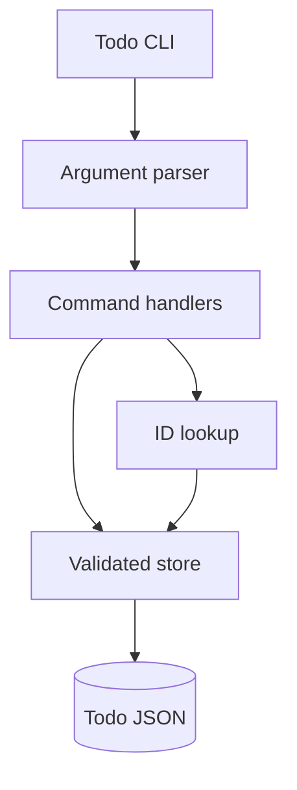

<h3>PR Summary by Qodo</h3>

Add done and remove commands with durable todo IDs

<!-- qodo-describe-risk-badge -->
<!-- /qodo-describe-risk-badge -->
<code>✨ Enhancement</code> <code>🐞 Bug fix</code> <code>🧪 Tests</code> <code>📝 Documentation</code> <code>🕐 20-40 Minutes</code>

<!-- qodo-describe-risk-slot -->

AI Description

<dl>
<dd>
 

><pre>
>• Add <b><i>done</i></b>, <b><i>remove</i></b>, and <b><i>list --all</i></b> to manage completed items.
>• Prevent ID reuse and reject duplicate IDs in hand-edited store files.
>• Return consistent errors for invalid IDs, with CLI and store regression tests.
></pre>

</dd>
</dl>

Diagram

<dl>
<dd>

 

</dd>
</dl>

High-Level Assessment

<dl>
<dd>

 

>Extending the existing CLI handlers and enforcing ID invariants at store load is appropriate: every command benefits from validated data, while deleted IDs remain unused through `next_id`. A separate ID registry would add complexity without improving this file-backed workflow. The documented, contrived overlong zero-padded ID case remains deferred.

</dd>
</dl>

 Files changed (8) <code> +401 / -13 </code> 

<dl>
<dd>

 

Enhancement (1) <code> +78 / -10 </code>

<dl>
<dd>

cli.py<code>Implement done, remove, and completed-item listing</code> <code>+78/-10</code>

 

>Implement done, remove, and completed-item listing
>
><pre>
>• Adds idempotent completion, deletion, and list --all with [x] markers. Validates plain ASCII-digit IDs, treats dash-led arguments as IDs for done and remove, and reports unknown IDs consistently.
></pre>
>
><a href='https://github.com/SigorMatt/pet-todo/pull/3/files#diff-66ca6b1b3ce0ce9622a7f5e5bb0ec10d15c0b582687a63e9d17bacf393d063fa'>todo/cli.py</a>

</dd>
</dl>

Bug fix (1) <code> +14 / -1 </code>

<dl>
<dd>

store.py<code>Preserve fresh IDs and reject duplicate stored IDs</code> <code>+14/-1</code>

 

>Preserve fresh IDs and reject duplicate stored IDs
>
><pre>
>• Raises a loaded next_id above every stored ID, with a minimum of 1, to prevent reuse after hand edits. Rejects duplicate item IDs as unreadable store data.
></pre>
>
><a href='https://github.com/SigorMatt/pet-todo/pull/3/files#diff-c7564f4bdfa07c8b5636c79fe9d89296b821f29291202a86bd6bae6f741ccdcf'>todo/store.py</a>

</dd>
</dl>

Tests (2) <code> +216 / -2 </code>

<dl>
<dd>

test_cli.py<code>Cover completion, removal, listing, and invalid IDs</code> <code>+153/-2</code>

 

>Cover completion, removal, listing, and invalid IDs
>
><pre>
>• Adds direct and subprocess tests for done, remove, list --all, and non-reused IDs. Exercises malformed, dash-led, help-like, and overlong IDs and their error messages.
></pre>
>
><a href='https://github.com/SigorMatt/pet-todo/pull/3/files#diff-4e8715c7a425ee52e74b7df4d34efd32e8c92f3e60bd51bc2e1ad5943b82032e'>tests/test_cli.py</a>

test_store.py<code>Test store ID repair and duplicate rejection</code> <code>+63/-0</code>

 

>Test store ID repair and duplicate rejection
>
><pre>
>• Checks that low next_id values are repaired without lowering valid values. Verifies duplicate IDs fail on load and cannot produce a misleading successful removal.
></pre>
>
><a href='https://github.com/SigorMatt/pet-todo/pull/3/files#diff-82dc23441f1c2284bff246aaa293e2a1e00231b9960c4d4768c19e9f4d8c7d0a'>tests/test_store.py</a>

</dd>
</dl>

Documentation (4) <code> +93 / -0 </code>

<dl>
<dd>

DISPOSITIONS.md<code>Record cold-review finding dispositions</code> <code>+7/-0</code>

 

>Record cold-review finding dispositions
>
><pre>
>• Records the fixes and test evidence for invalid IDs, duplicate IDs, and overlong inputs. Notes the deferred zero-padded ID edge case.
></pre>
>
><a href='https://github.com/SigorMatt/pet-todo/pull/3/files#diff-0c7883471e978108dbac3fee8a8d4219fbdbd66583ff07be874ac8967a8e0781'>reviews/cold/M2/DISPOSITIONS.md</a>

round-1.md<code>Document initial cold-review findings</code> <code>+25/-0</code>

 

>Document initial cold-review findings
>
><pre>
>• Documents initial ID parsing and duplicate-ID findings, acceptance-criteria coverage, and scope.
></pre>
>
><a href='https://github.com/SigorMatt/pet-todo/pull/3/files#diff-3047214ede5454b84536e5b32fc5c7d57151dc7eea2b6718be58d4735241143a'>reviews/cold/M2/round-1.md</a>

round-2.md<code>Document follow-up review of ID handling</code> <code>+31/-0</code>

 

>Document follow-up review of ID handling
>
><pre>
>• Records the overlong-digit regression found after the ASCII-digit fix and verifies earlier fixes.
></pre>
>
><a href='https://github.com/SigorMatt/pet-todo/pull/3/files#diff-a7f2e476a41b94070334f6e52288cf49259207fd49ed5e6b145de57fed30563e'>reviews/cold/M2/round-2.md</a>

scoped-1.md<code>Document scoped review of the overlong-ID fix</code> <code>+30/-0</code>

 

>Document scoped review of the overlong-ID fix
>
><pre>
>• Verifies the overlong-ID error handling and records the remaining zero-padded ID edge case.
></pre>
>
><a href='https://github.com/SigorMatt/pet-todo/pull/3/files#diff-a64a1aeda68856956626e31ad59d36da08c83e347c78712202a74a2fc9477e85'>reviews/cold/M2/scoped-1.md</a>

</dd>
</dl>

</dd>
</dl>

<!-- qodo-describe-head:f7e4e1692f8b920db9255de5984efbd78dda7d3d -->