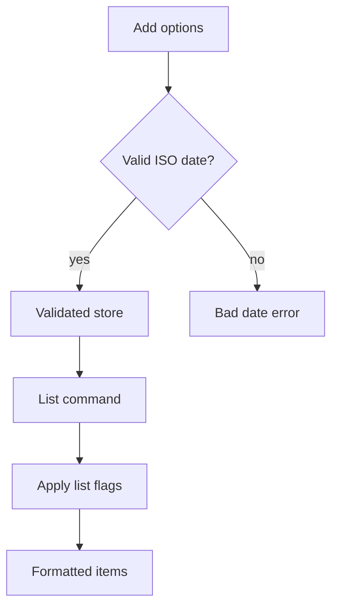

<h3>PR Summary by Qodo</h3>

Add due dates and overdue filtering to the todo CLI

<!-- qodo-describe-risk-badge -->
<!-- /qodo-describe-risk-badge -->
<code>✨ Enhancement</code> <code>🧪 Tests</code> <code>🕐 20-40 Minutes</code>

<!-- qodo-describe-risk-slot -->

AI Description

<dl>
<dd>
 

><pre>
>• Store and display strictly validated due dates on todo items.
>• List only open items due before an injectable today date.
>• Reject invalid dates without changing the file, with tests covering parsing and persistence.
></pre>

</dd>
</dl>

Diagram

<dl>
<dd>

 

</dd>
</dl>

High-Level Assessment

<dl>
<dd>

 

>Keep date validation shared through the store module: it gives CLI input and stored data the same strict rules without introducing another dependency. Injecting today at the CLI boundary makes overdue behavior testable without changing the persistence model.

</dd>
</dl>

 Files changed (7) <code> +368 / -7 </code> 

<dl>
<dd>

 

Enhancement (2) <code> +85 / -6 </code>

<dl>
<dd>

cli.py<code>Add due-date input and overdue listing</code> <code>+68/-6</code>

 

>Add due-date input and overdue listing
>
><pre>
>• Adds --due to add and --overdue to list, displays stored due dates, and accepts an injectable today date. Normalizes dash-led due values before argument parsing so invalid dates receive the intended error without writing the file.
></pre>
>
><a href='https://github.com/SigorMatt/pet-todo/pull/4/files#diff-66ca6b1b3ce0ce9622a7f5e5bb0ec10d15c0b582687a63e9d17bacf393d063fa'>todo/cli.py</a>

store.py<code>Validate optional due dates in stored items</code> <code>+17/-0</code>

 

>Validate optional due dates in stored items
>
><pre>
>• Adds strict YYYY-MM-DD calendar-date validation and applies it to the optional due field when loading items. Existing save behavior preserves the field.
></pre>
>
><a href='https://github.com/SigorMatt/pet-todo/pull/4/files#diff-c7564f4bdfa07c8b5636c79fe9d89296b821f29291202a86bd6bae6f741ccdcf'>todo/store.py</a>

</dd>
</dl>

Tests (2) <code> +230 / -1 </code>

<dl>
<dd>

test_cli.py<code>Cover due-date and overdue CLI behavior</code> <code>+197/-1</code>

 

>Cover due-date and overdue CLI behavior
>
><pre>
>• Adds tests for storing and displaying due dates, invalid-date errors without file changes, and overdue filtering against an injected today date. Also covers dash-led values, option boundaries, and interactions with existing commands.
></pre>
>
><a href='https://github.com/SigorMatt/pet-todo/pull/4/files#diff-4e8715c7a425ee52e74b7df4d34efd32e8c92f3e60bd51bc2e1ad5943b82032e'>tests/test_cli.py</a>

test_store.py<code>Test due-date validation and persistence</code> <code>+33/-0</code>

 

>Test due-date validation and persistence
>
><pre>
>• Verifies valid due dates survive load and save, while non-ISO or impossible stored dates raise StoreError.
></pre>
>
><a href='https://github.com/SigorMatt/pet-todo/pull/4/files#diff-82dc23441f1c2284bff246aaa293e2a1e00231b9960c4d4768c19e9f4d8c7d0a'>tests/test_store.py</a>

</dd>
</dl>

Documentation (3) <code> +53 / -0 </code>

<dl>
<dd>

DISPOSITIONS.md<code>Record the disposition of the dash-led date finding</code> <code>+3/-0</code>

 

>Record the disposition of the dash-led date finding
>
><pre>
>• Documents the review finding, its fix, and the regression-test evidence.
></pre>
>
><a href='https://github.com/SigorMatt/pet-todo/pull/4/files#diff-4ebd9dec59d97303a81e3ba11712bc254acdc6c921007cccb4b8022c07978c90'>reviews/cold/M3/DISPOSITIONS.md</a>

round-1.md<code>Document the first cold-review findings</code> <code>+22/-0</code>

 

>Document the first cold-review findings
>
><pre>
>• Records the original dash-led date error and evidence for the mission criteria.
></pre>
>
><a href='https://github.com/SigorMatt/pet-todo/pull/4/files#diff-091dc33c15d00066ee51d8d5819f07d6364c08e7379e869becc3607dcf4a330d'>reviews/cold/M3/round-1.md</a>

round-2.md<code>Document the follow-up cold review</code> <code>+28/-0</code>

 

>Document the follow-up cold review
>
><pre>
>• Records a review with no new findings and verifies the earlier fix and test coverage.
></pre>
>
><a href='https://github.com/SigorMatt/pet-todo/pull/4/files#diff-9d2684f8d48f79a5953e14945710c8bfb7f207cf8a617e7314ce2138087706ce'>reviews/cold/M3/round-2.md</a>

</dd>
</dl>

</dd>
</dl>

<!-- qodo-describe-head:8f52fb6971a85dfbd019bc075397c4187f3b709c -->