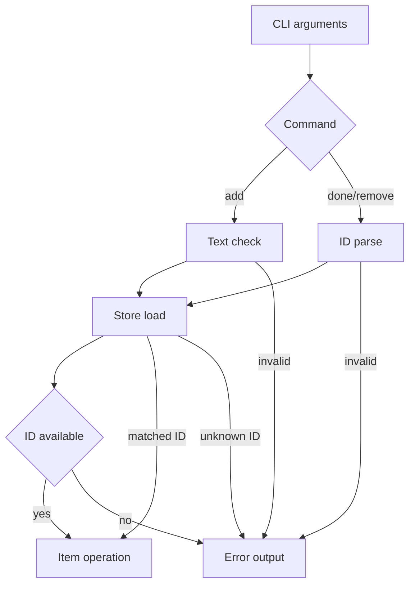

<h3>PR Summary by Qodo</h3>

Validate task text and IDs before loading the todo file

<!-- qodo-describe-risk-badge -->
<!-- /qodo-describe-risk-badge -->
<code>✨ Enhancement</code> <code>🧪 Tests</code> <code>📝 Documentation</code> <code>🕐 20-40 Minutes</code>

<!-- qodo-describe-risk-slot -->

AI Description

<dl>
<dd>
 

><pre>
>• Reject invalid task text and malformed IDs before loading the file, leaving it unchanged.
>• Report ID exhaustion as <b><i>todo: no more ids</i></b> instead of a write failure.
>• Expand CLI and subprocess tests for validation, unchanged files, and UTF-8 output.
></pre>

</dd>
</dl>

Diagram

<dl>
<dd>

 

</dd>
</dl>

High-Level Assessment

<dl>
<dd>

 

>Keep the shared CLI validators: they produce the required errors before file loading and can be reused by later commands. Argparse-level or store-level validation would complicate those error and ordering guarantees.

</dd>
</dl>

 Files changed (4) <code> +294 / -65 </code> 

<dl>
<dd>

 

Enhancement (1) <code> +67 / -14 </code>

<dl>
<dd>

cli.py<code>Validate text and IDs before store access</code> <code>+67/-14</code>

 

>Validate text and IDs before store access
>
><pre>
>• Adds reusable text and ID validators, applying them to add and done/remove before loading the file. Separates malformed IDs from well-formed missing IDs and reports exhausted IDs with &#x27;todo: no more ids&#x27;.
></pre>
>
><a href='https://github.com/SigorMatt/pet-todo/pull/6/files#diff-66ca6b1b3ce0ce9622a7f5e5bb0ec10d15c0b582687a63e9d17bacf393d063fa'>todo/cli.py</a>

</dd>
</dl>

Tests (1) <code> +201 / -51 </code>

<dl>
<dd>

test_cli.py<code>Cover strict IDs, clean text, and ID exhaustion</code> <code>+201/-51</code>

 

>Cover strict IDs, clean text, and ID exhaustion
>
><pre>
>• Moves malformed-ID cases to bad-ID expectations while preserving unknown-item coverage and file-unchanged checks. Adds text-validation, one-line listing, real non-UTF-8 argv, strict-UTF-8 output, and ID-exhaustion tests.
></pre>
>
><a href='https://github.com/SigorMatt/pet-todo/pull/6/files#diff-4e8715c7a425ee52e74b7df4d34efd32e8c92f3e60bd51bc2e1ad5943b82032e'>tests/test_cli.py</a>

</dd>
</dl>

Documentation (2) <code> +26 / -0 </code>

<dl>
<dd>

DISPOSITIONS.md<code>Record no cold-review findings</code> <code>+3/-0</code>

 

>Record no cold-review findings
>
><pre>
>• Adds the M4 disposition table with no findings to resolve.
></pre>
>
><a href='https://github.com/SigorMatt/pet-todo/pull/6/files#diff-ae66d386c891289581eef103b3d1a67da4f519130954915fa63f1d3b3d5b2257'>reviews/cold/M4/DISPOSITIONS.md</a>

round-1.md<code>Document M4 cold-review coverage</code> <code>+23/-0</code>

 

>Document M4 cold-review coverage
>
><pre>
>• Records the reviewed criteria, test evidence, scope assessment, and absence of findings.
></pre>
>
><a href='https://github.com/SigorMatt/pet-todo/pull/6/files#diff-98282f578ef08ff2f85975e5b064123441adb0caff37a7cbb8a3e838eed04818'>reviews/cold/M4/round-1.md</a>

</dd>
</dl>

</dd>
</dl>

<!-- qodo-describe-head:53cab74a55fdcc0b3a7ed26cf18e6987c736c849 -->