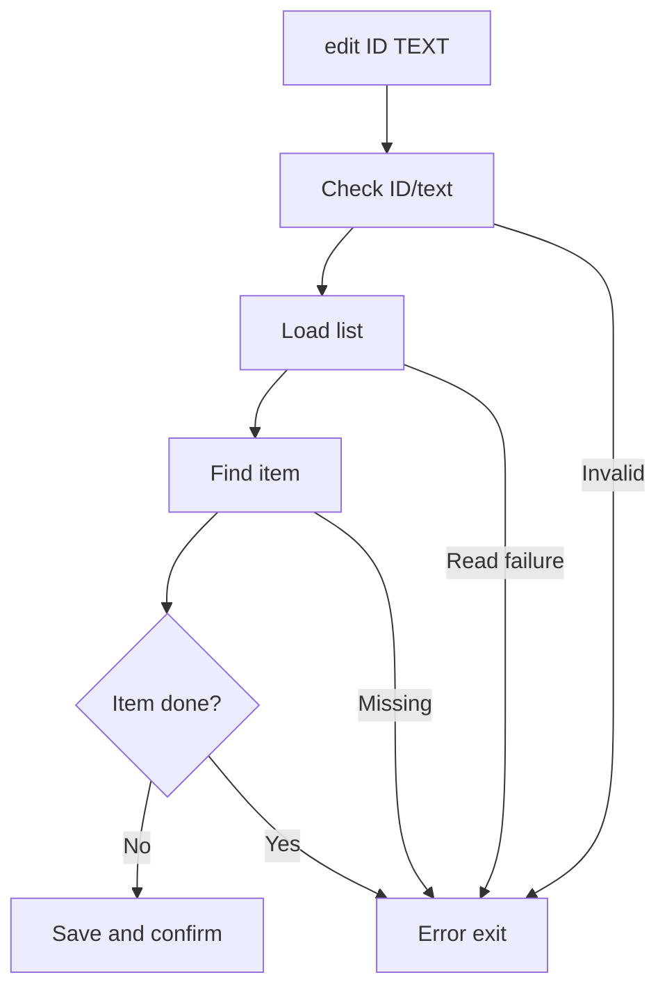

<h3>PR Summary by Qodo</h3>

Add an edit command for open todo items

<!-- qodo-describe-risk-badge -->
<!-- /qodo-describe-risk-badge -->
<code>✨ Enhancement</code> <code>🧪 Tests</code> <code>📝 Documentation</code> <code>🕐 20-40 Minutes</code>

<!-- qodo-describe-risk-slot -->

AI Description

<dl>
<dd>
 

><pre>
>• Add <b><i>todo edit ID TEXT</i></b> to replace an open item’s text without changing its other fields.
>• Reject done or unknown items, and validate IDs and text before loading the file.
>• Cover successful edits, error precedence, unchanged files, and subprocess behavior with tests.
></pre>

</dd>
</dl>

Diagram

<dl>
<dd>

 

</dd>
</dl>

High-Level Assessment

<dl>
<dd>

 

>The localized command handler is appropriate: it reuses existing validation, lookup, and atomic store operations. A generic mutation framework would add complexity without a clear benefit for this command.

</dd>
</dl>

 Files changed (5) <code> +269 / -1 </code> 

<dl>
<dd>

 

Enhancement (1) <code> +45 / -1 </code>

<dl>
<dd>

cli.py<code>Implement the edit command</code> <code>+45/-1</code>

 

>Implement the edit command
>
><pre>
>• Registers &#x27;edit ID TEXT&#x27; and replaces only the text of a found, open item before saving. Reuses ID and text checks before loading, handles dash-led IDs as bad IDs in supported argument forms, and reports done-item errors through the existing CLI error path.
></pre>
>
><a href='https://github.com/SigorMatt/pet-todo/pull/7/files#diff-66ca6b1b3ce0ce9622a7f5e5bb0ec10d15c0b582687a63e9d17bacf393d063fa'>todo/cli.py</a>

</dd>
</dl>

Tests (1) <code> +172 / -0 </code>

<dl>
<dd>

test_cli.py<code>Test edit behavior and failure paths</code> <code>+172/-0</code>

 

>Test edit behavior and failure paths
>
><pre>
>• Adds CLI and subprocess tests for text replacement, preservation of other fields, and rejection of done or missing items. Tests also cover malformed arguments, validation before file loading, failed writes, non-UTF-8 text, and byte-identical files after rejected edits.
></pre>
>
><a href='https://github.com/SigorMatt/pet-todo/pull/7/files#diff-4e8715c7a425ee52e74b7df4d34efd32e8c92f3e60bd51bc2e1ad5943b82032e'>tests/test_cli.py</a>

</dd>
</dl>

Documentation (3) <code> +52 / -0 </code>

<dl>
<dd>

DISPOSITIONS.md<code>Record no cold-review findings</code> <code>+3/-0</code>

 

>Record no cold-review findings
>
><pre>
>• Adds the M5 disposition ledger, indicating that no findings required disposition.
></pre>
>
><a href='https://github.com/SigorMatt/pet-todo/pull/7/files#diff-431857fdd84d426b0dcd31da0b9077442cc5e0e66cac2ed5838f87a3946ad09c'>reviews/cold/M5/DISPOSITIONS.md</a>

round-1.md<code>Document the first edit-command review</code> <code>+21/-0</code>

 

>Document the first edit-command review
>
><pre>
>• Records the first review’s criteria, test evidence, scope, and absence of findings. It describes the command before the later done-item restriction.
></pre>
>
><a href='https://github.com/SigorMatt/pet-todo/pull/7/files#diff-b06a3cd8172c306136fa00e592997842e8cc783ba8fdbd7b7d32ddd817551976'>reviews/cold/M5/round-1.md</a>

round-2.md<code>Document the done-item follow-up review</code> <code>+28/-0</code>

 

>Document the done-item follow-up review
>
><pre>
>• Records evidence for refusing edits to done items alongside the earlier edit criteria. It reports no findings in the second review.
></pre>
>
><a href='https://github.com/SigorMatt/pet-todo/pull/7/files#diff-fb2ec06ca6c4d8711c36aac29e577bb91c35696bbb778e8b3eb9d724d578a41a'>reviews/cold/M5/round-2.md</a>

</dd>
</dl>

</dd>
</dl>

<!-- qodo-describe-head:ca3a6bc005b657273ebf1c132778438dc4171aa4 -->