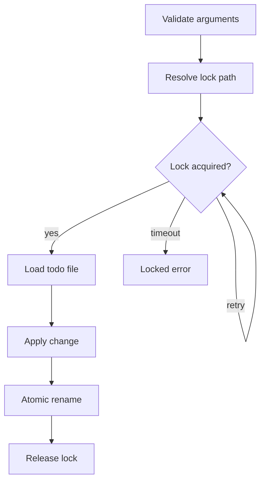

<h3>PR Summary by Qodo</h3>

Lock all to-do mutations across concurrent CLI runs

<!-- qodo-describe-risk-badge -->
<!-- /qodo-describe-risk-badge -->
<code>🐞 Bug fix</code> <code>🧪 Tests</code> <code>📝 Documentation</code> <code>🕐 20-40 Minutes</code>

<!-- qodo-describe-risk-slot -->

AI Description

<dl>
<dd>
 

><pre>
>• Lock add, done, remove, and edit across loading and saving to prevent lost changes.
>• Share locks across symlinks, wait up to five seconds, and preserve unlocked listing.
>• Add concurrency and failure-path tests; document review fixes and a deferred FIFO risk.
></pre>

</dd>
</dl>

Diagram

<dl>
<dd>

 

</dd>
</dl>

High-Level Assessment

<dl>
<dd>

 

>The following are alternative approaches to this PR:

<b>1. Centralize mutations in a store transaction API</b>

<dl>
<dd>

- ➕ Makes it harder for future changing commands to omit the lock.
- ➖ Requires a broader API refactor or moves command-specific mutation logic into the store.

</dd>
</dl>

>**Recommendation:** Keep the scoped sidecar-lock approach: it protects the full read-modify-write operation without locking the data-file inode that atomic rename replaces. Consider a transaction API if more mutation commands are added. The documented FIFO-at-lock-path case remains a bounded-wait gap and should be addressed separately.

</dd>
</dl>

 Files changed (9) <code> +717 / -24 </code> 

<dl>
<dd>

 

Bug fix (2) <code> +133 / -24 </code>

<dl>
<dd>

cli.py<code>Hold an exclusive lock for every changing command</code> <code>+39/-24</code>

 

>Hold an exclusive lock for every changing command
>
><pre>
>• Wraps each add, done, remove, and edit read-modify-save operation in the store lock while leaving validation before acquisition and list unlocked. Reports lock timeouts and maps lock-file open failures to write errors.
></pre>
>
><a href='https://github.com/SigorMatt/pet-todo/pull/8/files#diff-66ca6b1b3ce0ce9622a7f5e5bb0ec10d15c0b582687a63e9d17bacf393d063fa'>todo/cli.py</a>

store.py<code>Add a timed sidecar-file lock</code> <code>+94/-0</code>

 

>Add a timed sidecar-file lock
>
><pre>
>• Adds an exclusive flock context manager with configurable polling and timeout, keyed to the resolved data path so aliases share a lock. Falls back to opening an existing unwritable lock file read-only.
></pre>
>
><a href='https://github.com/SigorMatt/pet-todo/pull/8/files#diff-c7564f4bdfa07c8b5636c79fe9d89296b821f29291202a86bd6bae6f741ccdcf'>todo/store.py</a>

</dd>
</dl>

Tests (3) <code> +497 / -0 </code>

<dl>
<dd>

test_cli.py<code>Test CLI locking across mutations and failures</code> <code>+273/-0</code>

 

>Test CLI locking across mutations and failures
>
><pre>
>• Checks that all four changing commands hold the lock through load and rename and release it on success or failure. Covers timeouts, waiting, symlink aliases, read-only lock files, argument validation, and unlocked listing.
></pre>
>
><a href='https://github.com/SigorMatt/pet-todo/pull/8/files#diff-4e8715c7a425ee52e74b7df4d34efd32e8c92f3e60bd51bc2e1ad5943b82032e'>tests/test_cli.py</a>

test_concurrency.py<code>Verify concurrent adds preserve items and IDs</code> <code>+75/-0</code>

 

>Verify concurrent adds preserve items and IDs
>
><pre>
>• Starts two workers that each invoke the CLI 50 times against one file. Verifies every add succeeds and all 100 items and IDs survive.
></pre>
>
><a href='https://github.com/SigorMatt/pet-todo/pull/8/files#diff-74d167fcbbef5f84158cb3b83eb316e19827edb0c5719e022b9a27c81ae9ccdf'>tests/test_concurrency.py</a>

test_store.py<code>Test lock acquisition, release, and path resolution</code> <code>+149/-0</code>

 

>Test lock acquisition, release, and path resolution
>
><pre>
>• Covers lock creation, timeout and retry behavior, release after exceptions, and a shared lock path for symlinks and targets. Tests read-only fallback when an existing lock file cannot be opened for writing.
></pre>
>
><a href='https://github.com/SigorMatt/pet-todo/pull/8/files#diff-82dc23441f1c2284bff246aaa293e2a1e00231b9960c4d4768c19e9f4d8c7d0a'>tests/test_store.py</a>

</dd>
</dl>

Documentation (4) <code> +87 / -0 </code>

<dl>
<dd>

DISPOSITIONS.md<code>Record cold-review dispositions</code> <code>+6/-0</code>

 

>Record cold-review dispositions
>
><pre>
>• Tracks the symlink-lock and read-only lock-file fixes with regression evidence. Records the FIFO lock-path hang as deferred work.
></pre>
>
><a href='https://github.com/SigorMatt/pet-todo/pull/8/files#diff-639a775ebd6e1ae6af29a31d15e9fcef00d166aca6921d8ed36db04ca7cc519d'>reviews/cold/M6/DISPOSITIONS.md</a>

round-1.md<code>Document initial symlink-lock findings</code> <code>+23/-0</code>

 

>Document initial symlink-lock findings
>
><pre>
>• Records reproduced races and write failures when the lock was placed beside an unresolved symlink, along with initial acceptance-test evidence.
></pre>
>
><a href='https://github.com/SigorMatt/pet-todo/pull/8/files#diff-e9d476f2881aff621b68cec3fb86e087de3a2cc32a0641331e7b975457299c26'>reviews/cold/M6/round-1.md</a>

round-2.md<code>Document lock-file permission finding</code> <code>+29/-0</code>

 

>Document lock-file permission finding
>
><pre>
>• Records the shared-directory failure caused by opening an existing lock file read-write and confirms the earlier symlink fixes.
></pre>
>
><a href='https://github.com/SigorMatt/pet-todo/pull/8/files#diff-ba923dc65825cb9a627ea2b43af1d25c3e0486a4b7cb50a67fa2df7799ecccfc'>reviews/cold/M6/round-2.md</a>

scoped-1.md<code>Document read-only fallback review</code> <code>+29/-0</code>

 

>Document read-only fallback review
>
><pre>
>• Records evidence that read-only descriptors can hold and wait for the lock. Identifies an unresolved hang when the fallback opens a planted FIFO.
></pre>
>
><a href='https://github.com/SigorMatt/pet-todo/pull/8/files#diff-e67d82884e7a22283b6a4dead4df69e4b5033215023f529bb4afdfb0509580f9'>reviews/cold/M6/scoped-1.md</a>

</dd>
</dl>

</dd>
</dl>

<!-- qodo-describe-head:f3e4b8ac7d2a77f06ce9c1093325c94690d184a5 -->